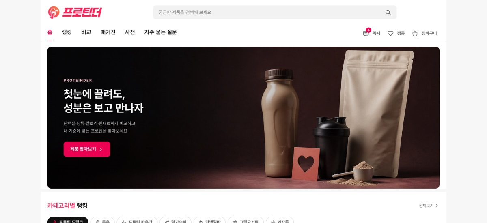
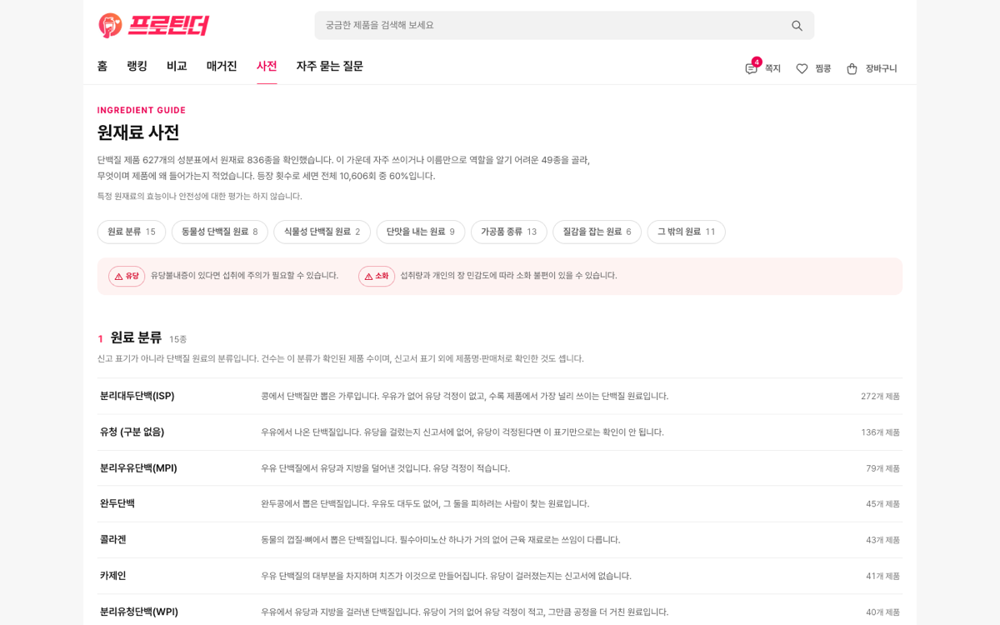

# 프로틴더

단백질 음료와 파우더를 원재료와 영양성분으로 비교하는 웹 서비스



| 기간 | 대회 | 결과 | 배포 |
|---|---|---|---|
| 2026.7.21 ~ 8.8 (본선 무박 2일) | 서울시립대 모두의 창업 비긴즈 해커톤 | 장려상 | https://proteinder.vercel.app |

## 문제의식

- 성분표를 봐도 제품의 좋고 나쁨을 알기 어려움
- 제품 이름에는 산양유, WPI가 크게 표기
- 그 원료의 배합 순번, 당류와 감미료의 종류는 긴 원재료 목록을 직접 읽어야 확인 가능
- 설문에서도 유당, 인공감미료, 단백질 원료 비율을 한눈에 비교하기 어렵다는 응답 다수

## 해결 방법

- 공공데이터에 신고된 원재료와 영양성분 수집
- 긴 원재료 목록을 단백질 원료, 당류, 감미료, 알 수 없는 표기 네 칸으로 정리, 배합 순번 유지
- 영양성분을 1회 섭취 기준으로 통일해 같은 기준으로 비교

## 주요 기능

- 제품 검색: 카테고리 일곱 개, 단백질량·칼로리·당류 필터
- 제품 상세: 원재료 네 칸 요약, 1회 섭취 기준 영양 오각형
- 이름과 원료 대조: 이름에 적힌 원료가 원재료 목록에 없는 제품을 거르는 필터
- 두 제품 비교(`/compare`)
- 원재료 사전: WPI, ISP 같은 원료 표기 설명
- 상황별 단백질 계산기



## 만들며 부딪힌 문제

- 1병당 단백질이 실제의 절반으로 표시
  - 원인: 신고 자료의 1회 제공량 칸과 영양성분 기준량 칸이 다른데 앞의 칸으로 환산
  - 해결: 기준량 칸으로 환산, 음료는 1병·파우더는 1회분 30g 기준으로 구분
- 제품 사진 매칭 실패 다수
  - 원인: 띄어쓰기 없는 제품명은 낱말 겹침 점수가 항상 낮게 계산
  - 해결: 글자 두 개 단위 겹침을 함께 계산, 맛이 다른 사진은 후보에서 제외
- 쇼핑몰 검색 차단으로 가격 수집 불가
  - 원인: 쇼핑몰 검색 경로 차단, 제휴 API 승인 대기
  - 해결: 가격 기능 제외, 사진은 이미지 검색으로 확보

## 돌아본 점

- 잘된 것: 공공 자료에 없는 원료를 지어내지 않고 '원료 불명확'으로 표시
- 잘못된 것: 주색을 하루에 두 번 바꿨다가 원복, 성분 점수 카드도 만들었다가 폐기
- 다시 한다면: 색 수 축소, 버튼 글자 대비 수정, 로그인과 리뷰 기능의 배포본 연결

## 기술

- Next.js 16, React 19, Tailwind CSS 4, 제품·원료 페이지는 빌드 시 정적 생성
- 로그인과 리뷰는 Supabase, 지금 배포본은 미연결이라 두 기능은 꺼진 상태
- AI 도구: 자료 수집·정제 스크립트와 화면 구현을 AI 코딩 도구(Claude Code)로 진행

## 자료 출처 · 실행

- 식품안전나라 공공데이터(품목제조보고 원재료, 영양성분). 검수를 거쳐 원재료가 확인된 제품만 수록, 가공한 자료는 `data/`
- 제품 사진은 쇼핑몰과 제조사 이미지라 저장소에서 제외, 배포본에만 수록

```bash
npm install
npm run dev
```

로그인과 리뷰 사용 시 `.env.example`을 참고해 `NEXT_PUBLIC_SUPABASE_URL`, `NEXT_PUBLIC_SUPABASE_ANON_KEY` 입력
